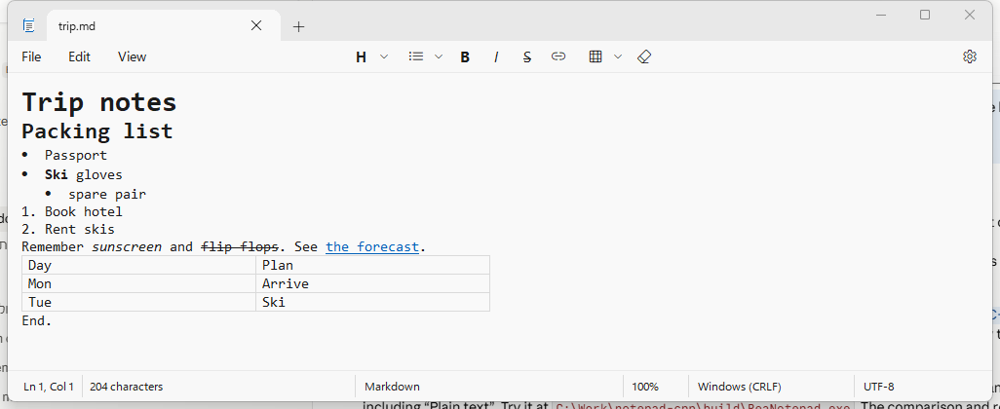
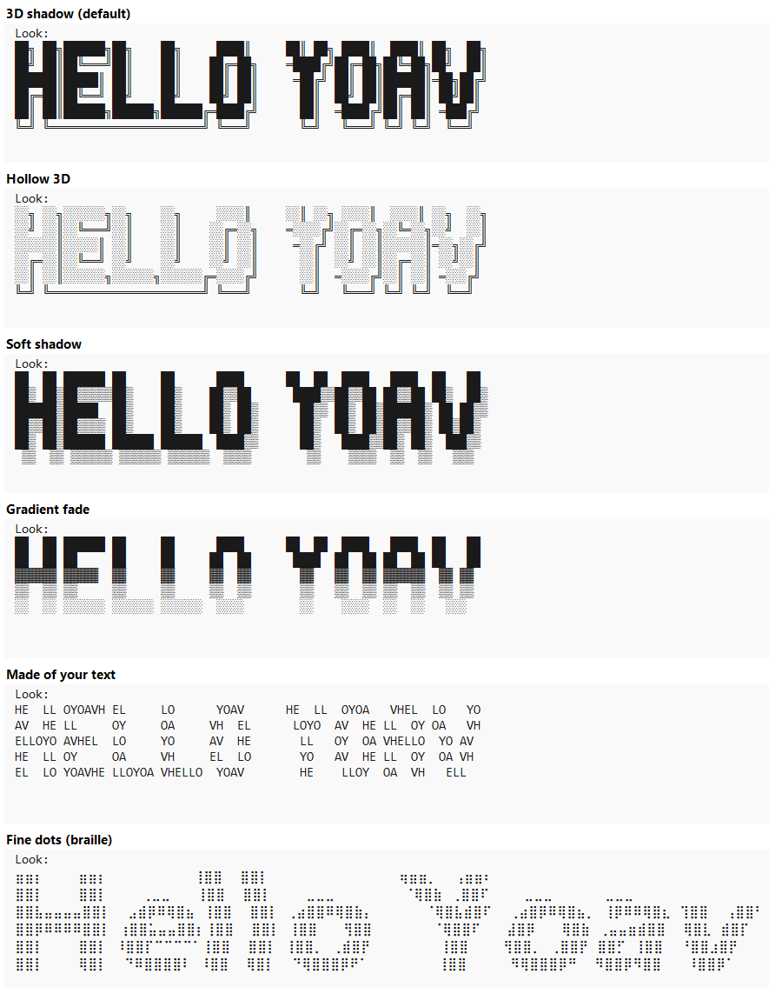

# Notepad--

A Windows 11 Notepad lookalike written from scratch in C++ (Win32 + RichEdit, no XAML and no
Microsoft code or assets). The layout, menus, toolbar, dialogs and settings page were measured
from Windows Notepad 11.2607 with the help of the [rea](https://github.com/morluto/rea)
reverse-engineering tools and UI Automation; see [ANALYSIS.md](ANALYSIS.md) for the details
and the feature checklist.

Extra, not in Windows Notepad: type `##some text##` followed by any key and the text turns into
ASCII art on the lines below. `#S3H2#some text##` picks style 3 and height 2 for one banner
(the codes are shown in Edit > ASCII art).




## Install on a Snapdragon (Windows on ARM64) laptop

Everything below runs in **PowerShell** on the laptop. No administrator rights are needed
except for the Build Tools installer, which Windows will ask about.

1. **Install the C++ Build Tools with the ARM64 compiler** (about 3 GB, 10-20 minutes):

   ```powershell
   winget install --id Microsoft.VisualStudio.2022.BuildTools -e --override "--quiet --wait --norestart --add Microsoft.VisualStudio.Workload.VCTools --add Microsoft.VisualStudio.Component.VC.Tools.ARM64 --includeRecommended"
   ```

2. **Install Git** (skip if `git --version` already works), then open a new PowerShell window:

   ```powershell
   winget install --id Git.Git -e
   ```

3. **Get the source:**

   ```powershell
   git clone https://github.com/YoavDahanPrivate/REA_Notepad.git
   cd REA_Notepad
   ```

4. **Build.** On an ARM64 laptop this builds a native ARM64 exe at `build\arm64\Notepad--.exe`:

   ```powershell
   .\build.bat
   ```

5. **Install** (copies the app to `%LOCALAPPDATA%\Programs\Notepad--`, adds it to
   Start > All apps and to Settings > Apps > Installed apps):

   ```powershell
   powershell -ExecutionPolicy Bypass -File .\install.ps1
   ```

6. **Pin it to Start** (Windows doesn't let apps pin themselves): open Start > All apps,
   right-click **Notepad--** > **Pin to Start**, then drag it where you want it, e.g. after
   Settings.

To update later: `git pull`, `.\build.bat`, then run `install.ps1` again.
To uninstall: Settings > Apps > Installed apps > Notepad-- > Uninstall.

## Other ways to build

| Command | Result |
|---|---|
| `build.bat` | Exe for this PC's processor (x64 or ARM64) |
| `build.bat arm64` | ARM64 exe; on an x64 PC this cross-compiles (needs the ARM64 component from step 1) |
| `build.bat x64` | x64 exe; on ARM64 it builds an x64 exe that runs under emulation |

Outputs go to `build\<arch>\Notepad--.exe`. `install.ps1 -Arch arm64` (or `x64`) installs a
specific build; by default it picks the one matching the PC.

**Cross-compiling for the laptop from an x64 PC:** install the Build Tools as in step 1 on the
x64 PC, run `build.bat arm64`, then copy the whole folder (with `build\arm64`) to the laptop and
run `install.ps1` there. Without the ARM64 component, `build.bat` on the x64 PC still works; the
x64 exe also runs on Snapdragon laptops through Windows' x64 emulation, just a little slower.

## Checking a build

```powershell
.\build\arm64\Notepad--.exe --selftest selftest.log
Get-Content selftest.log
```

It checks Markdown round trips, the formatting commands, tables, links and the ASCII art
feature, and ends with `RESULT: all passed`.

## Source layout

| File | What it does |
|---|---|
| `src\main.cpp` | Main window, tabs, editor, menus, find/replace, settings page, files, printing |
| `src\flyout.cpp` | WinUI-style menu flyouts (menus, dropdowns, context menus) |
| `src\dialog.cpp` | ContentDialog-style dialogs and the What's new tour |
| `src\markdown.cpp` | Markdown model used for formatted text |
| `src\ascii.cpp` | ASCII art renderer (block letters, shadows, braille) |
| `src\ui.cpp` | Shared fonts, colors and drawing helpers |
| `src\notepad.rc`, `src\app.manifest`, `src\app.ico` | Resources, manifest and the app icon (drawn by the app itself) |
| `build.bat`, `install.ps1` | Build and per-user install |

Settings are stored in `HKCU\Software\ReaNotepad`.
